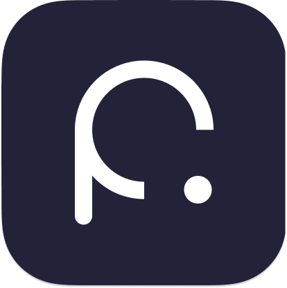

<!-- Hallmark · pre-emit critique: P4 H4 E4 S5 R5 V4 -->

<h1 align="center">Hi, I'm Zewail</h1>

  <strong>Independent developer · macOS, iOS &amp; Web</strong>

  I build apps for everyday work, creativity, and learning. 
  独立开发者，做实用的工具，也做帮助人们创作和学习的产品。

  <a href="https://www.zewail.org/"><strong>Portfolio ↗</strong></a> &nbsp;·&nbsp;
  <a href="https://www.pasteon.app/">Pasteon ↗</a> &nbsp;·&nbsp;
  <a href="mailto:chanzewail@gmail.com">Email</a>

## Selected apps

<table width="100%">
<tr>
  <td width="72" align="center" valign="middle"></td>
  <td valign="middle"><strong><a href="https://www.pasteon.app/">Pasteon</a></strong> &nbsp; <code>macOS</code> Search clipboard history, run custom workflows, and sync clips across nearby Macs.</td>
</tr>
<tr>
  <td width="72" align="center" valign="middle"></td>
  <td valign="middle"><strong><a href="https://apps.apple.com/us/app/rightkit-right-click-tools/id6800675908">RightKit</a></strong> &nbsp; <code>macOS</code> Create files, convert images, and access everyday tools from Finder's right-click menu.</td>
</tr>
<tr>
  <td width="72" align="center" valign="middle"></td>
  <td valign="middle"><strong><a href="https://apps.apple.com/us/app/photoblot-border-master/id6739862738">Photoblot</a></strong> &nbsp; <code>iOS</code> Add borders to photos and prepare them for sharing.</td>
</tr>
<tr>
  <td width="72" align="center" valign="middle"></td>
  <td valign="middle"><strong><a href="https://apps.apple.com/us/app/decibel-meter-detector/id1576052678">Decibel Meter</a></strong> &nbsp; <code>iOS</code> Measure ambient sound, track noise levels, and export measurement reports.</td>
</tr>
<tr>
  <td width="72" align="center" valign="middle"></td>
  <td valign="middle"><strong><a href="https://www.hanzistroke.app/">Hanzi Stroke</a></strong> &nbsp; <code>iOS</code> Learn Chinese characters with HSK lessons, animated stroke order, and vocabulary practice.</td>
</tr>
</table>

Browse the full collection at **[zewail.org ↗](https://www.zewail.org/#work)**.

### In progress

<table width="100%">
<tr>
  <td width="72" align="center" valign="middle"></td>
  <td valign="middle"><strong>Say Chinese</strong> &nbsp; <code>iOS · In development</code> Mandarin practice with everyday dialogues, natural audio, pinyin, and daily review.</td>
</tr>
<tr>
  <td width="72" align="center" valign="middle"></td>
  <td valign="middle"><strong>Little Art</strong> &nbsp; <code>iOS · In development</code> Save children's artwork with their stories and voice, then make a printable art book.</td>
</tr>
</table>

## Toolkit

**Web** &nbsp; `TypeScript` `React` `Next.js` `Node.js` 
**Apps** &nbsp; `Swift` `Flutter` `Dart` 
**Backend** &nbsp; `PHP` `ThinkPHP` `Koa`

---

  Product feedback or collaboration: <a href="mailto:chanzewail@gmail.com"><strong>chanzewail@gmail.com ↗</strong></a>

